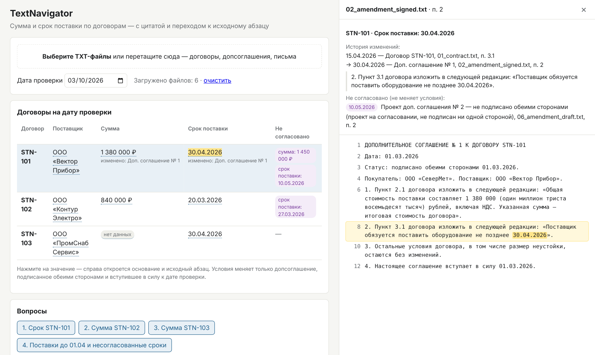
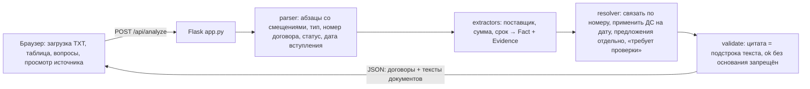

# TextNavigator — проверка условий договоров поставки

Прототип для специалиста по закупкам. Загружаете договоры, допсоглашения и письма в виде TXT и сразу видите по каждому договору **поставщика, сумму и срок поставки на дату проверки**. У каждого значения есть **файл, точная цитата и переход к абзацу** исходного текста. Если значение изменено, видно, каким документом. Несогласованные предложения (проекты, письма) показаны отдельно и условия не меняют. Если значения нет, прототип пишет «нет данных» и не подставляет догадку.



## Быстрый старт

Нужен Python 3.10+. Других зависимостей, кроме Flask (и pytest для тестов), нет. Платные API и ключи не нужны.

```bash
git clone https://github.com/VladShashkov/TextNavigator.git
cd TextNavigator
python -m venv .venv && source .venv/bin/activate      # Windows: .venv\Scripts\activate
pip install -r requirements.txt
python app.py                                           # → http://127.0.0.1:5000
```

1. Откройте http://127.0.0.1:5000 и выберите (или перетащите) все файлы из папки `documents/`.
2. Дата проверки по умолчанию 10.03.2026, её можно поменять, пересчёт идёт сразу.
3. Нажмите на значение в таблице: справа откроется основание, история изменений и исходный текст с подсвеченным абзацем.
4. Кнопки «Вопросы» отвечают на четыре вопроса задания. Те же ответы дают формы «Значение по договору» и «Поставка раньше даты» для любого договора и любой даты.

Запуск без интерфейса и проверки:

```bash
python -m textnavigator documents/ --date 2026-03-10    # таблица в консоли (--json — полный результат)
python -m pytest -q                                     # 25 тестов
python eval/run_eval.py                                 # метрики на эталонном наборе
```

### Ответы на вопросы задания (дата проверки 10.03.2026)

| # | Вопрос | Ответ прототипа | Основание |
|---|---|---|---|
| 1 | Срок поставки STN-101 | **30.04.2026**. Не согласовано: 10.05.2026 по проекту ДС № 2 | `02_amendment_signed.txt`, п. 2. Было 15.04.2026 по `01_contract.txt`, п. 3.1 |
| 2 | Сумма STN-102 | **840 000 ₽** (аванс 252 000 ₽ сюда не входит) | `03_contract.txt`, п. 2.1 |
| 3 | Сумма STN-103 | **нет данных**: сумма задана в приложении № 1, его нет в комплекте. Лимит бюджета 600 000 ₽ суммой договора не является | `04_contract.txt`, п. 2.1 |
| 4 | Поставка раньше 01.04.2026 и несогласованные сроки | **STN-102** (20.03.2026). Есть несогласованный перенос на 27.03.2026 из письма поставщика. Вне выборки: у STN-101 тоже есть несогласованное изменение срока, предложено 10.05.2026 | `03_contract.txt`, п. 3.1; `05_supplier_email.txt` |

Ответы не зашиты в код. Их вычисляет общий конвейер из загруженного текста, имена файлов на результат не влияют (это покрыто тестом). В `eval/fixtures/` лежат файлы для демонстрации: договор с изменённой суммой, новый договор STN-104, ДС «направлено на подписание» и ДС, вступающее в силу после даты проверки.

## Известные ограничения

- **Формат.** Только TXT (UTF-8 или cp1251). Каждый пункт — отдельная строка, как в учебных файлах. PDF, DOCX, OCR и таблицы спецификаций не поддерживаются.
- **Формулировки.** Правила распознают типовые формулировки: «Общая стоимость … составляет N рублей», «обязуется поставить … не позднее ДАТА», «изменить … на …», «перенести срок поставки с … на …», строка «Статус: подписан обеими сторонами ДАТА», «вступает в силу ДАТА». На другой формулировке система выдаст «нет данных» или «требует проверки», а не выдуманное значение. Но это значит, что возможен **ложный отказ**: значение в тексте есть, а система его не нашла.
- **Сроки.** Только даты (`15.04.2026`, `«15» апреля 2026 г.`). Относительные сроки («в течение 30 дней после оплаты») и поэтапные поставки не вычисляются. Несколько разных сроков в одном договоре дают «требует проверки».
- **Суммы.** Только рубли. Сумма прописью с суммой цифрами не сверяется. Относительное изменение («увеличить на 100 000») не пересчитывается в итог и помечается «требует проверки».
- **Статус документа.** Определяется по строке «Статус:», а не по блоку подписей или ЭП. Письмо никогда не меняет условия, как требует правило задания.
- **Связь документов.** Документ связывается с договором по номеру в тексте (заголовок, а для письма — первое упоминание «договор №…»). Документы без номера попадают в список «Не удалось связать».
- **Хранение.** Сервер ничего не хранит, а ручной правки и подтверждения значений нет. Это локальный прототип без авторизации.

---

## Записка

### Для кого и какая задача

**Пользователь** — специалист по закупкам, который сверяет условия поставок перед приёмкой, оплатой или претензией. Его боль не в чтении одного договора, а в цепочке документов: договор, подписанные и неподписанные допсоглашения, письма поставщика. Ошибка стоит денег: неверная неустойка, пропущенный срок, оплата по сумме из проекта. Поэтому главное свойство прототипа — **проверяемость**: каждое значение можно за один клик сверить с источником, а неуверенность видна явно.

### Пять вопросов клиенту перед развитием решения

1. В каких форматах и системах живут документы (СЭД, почта, сканы, 1С/ERP)? Сколько среди них сканов без текстового слоя?
2. Какие поля, кроме суммы и срока, нужны для решений, и какое решение принимается по результату (оплата, претензия, план поставок)? От этого зависит цена ошибки и порог автоматизации.
3. Что у вас считается «действующим» документом: подписание ЭП в СЭД, бумажный оригинал, регистрация в реестре договоров? Кто разрешает спорные случаи?
4. Сколько договоров и изменений в месяц, и сколько времени сейчас уходит на одну сверку? Это база для оценки эффекта.
5. Какие требования ИБ: локальный контур, разграничение доступа к договорам по подразделениям, журнал просмотров, допустимость внешних LLM?

### Принятые допущения

- Дата проверки задаётся пользователем. Условия меняет только ДС, подписанное обеими сторонами, если и подпись, и дата вступления в силу не позже даты проверки. Подписанное ДС без даты вступления в силу получает «требует проверки» (п. 5.1 договоров требует такую дату).
- Изменения применяются в порядке даты вступления в силу, а не по имени файла или порядку загрузки. Если в одну дату вступают ДС с разными значениями, это «требует проверки».
- Сумма — только итоговая стоимость договора. Аванс, лимит бюджета и сумма по приложению, которого нет в комплекте, суммой не считаются.
- Срок поставки — только срок по обязанности поставить. Сроки оплаты и приёмки сюда не входят.
- «Нет данных» означает, что значение не найдено или в тексте прямо сказано, что его нет. «Требует проверки» означает, что значение может быть, но надёжно его определить нельзя.

### Две метрики

1. **Доля выдуманных значений** (цель 0). Это поля, где по эталону «нет данных» или «требует проверки», а система вернула число или дату. Это главная метрика доверия: одна выдумка обесценивает весь инструмент.
2. **Точность по полю с верным основанием.** Значение, статус и файл-источник совпали с эталоном, а цитата дословно совпадает с текстом. Метрика продукта рядом: доля значений, которые пользователь принял без ручной правки, и время одной сверки до и после внедрения.

Текущий прогон `eval/run_eval.py`: 4 кейса, 13 полей. Точность 13/13, верный источник 13/13, несогласованные изменения найдены 5/5, выдуманных значений 0, цитаты совпадают дословно 32/32. **Важно:** это набор, на котором правила разрабатывались, то есть регрессионный тест, а не оценка обобщения. Для честной оценки нужны 50–100 реальных договоров, отложенных до разработки правил, и доверительный интервал для каждой метрики. При 100% на 13 полях нижняя граница 95% интервала около 75%.

### Архитектура



Код: `textnavigator/` — ядро без внешних зависимостей (~770 строк), `app.py` — HTTP-обёртка, `static/` — страница на чистом JS, `tests/` и `eval/` — проверки.

### Три ключевых решения и компромиссы

1. **Правила вместо LLM в ядре.** Плюсы: детерминированно, бесплатно, работает без сети и ключей, каждое значение имеет точное основание, а ошибку можно найти и исправить с регресс-тестом. Минус: хрупкость к новым формулировкам. Смягчено безопасным отказом: незнакомая формулировка даёт «нет данных» или «требует проверки», а не выдумку. LLM разумно добавить позже как второй экстрактор. Его факт принимается, только если цитата дословно есть в тексте, а расхождение с правилами даёт «требует проверки».
2. **Документ как единица юридического статуса, отдельно от извлечения.** Парсер определяет тип, статус и дату вступления, экстракторы — значения, resolver применяет правило задания. Плюс: правило «что действует» живёт в одном месте, его легко показать заказчику и поменять, а новое поле (например, неустойка) добавляется одной функцией в `EXTRACTORS`. Минус: больше кода, чем у прямого поиска ответа.
3. **Основание хранится как смещения в тексте, плюс инвариант.** Каждое значение несёт файл, id абзаца, цитату и диапазон подсветки, а `validate()` проверяет, что цитата — точная подстрока. При нарушении договор переводится в «требует проверки». Плюс: проверяемость гарантирована кодом, а не обещанием. Минус: привязка к конкретному тексту, поэтому при нормализации (OCR, DOCX) нужно хранить отображение смещений на оригинал.

### Что изменится при 100 000 документов и правах доступа

- **Обработка.** Перейти от синхронного запроса к фоновой индексации: очередь задач, воркеры разбора, результат в БД (PostgreSQL). Таблицы: `documents` с хешем текста и версией правил, `facts` с основанием, `contract_state` как кэш на дату. Пересчёт нужен только при новом документе по договору или новой версии правил.
- **Поиск и связывание.** Индекс по номеру договора, ИНН и названию поставщика. Полнотекстовый или гибридный поиск для документов без явного номера (письма). Очередь ручного разбора для несвязанных документов.
- **Доступ.** Права проверяются при выдаче, на уровне строк: договор и все его документы видит только тот, у кого есть доступ к договору в СЭД. Права наследуются из источника, а не дублируются. Журнал аудита фиксирует, кто какие значения смотрел и подтверждал. Обработка идёт в контуре заказчика, а для внешних LLM нужен шлюз обезличивания или локальная модель.
- **Качество.** Мониторинг доли «нет данных» и «требует проверки» по источникам документов. Её рост — сигнал нового шаблона договора.

### Три следующих улучшения по приоритету

1. **Подтверждение и исправление значения пользователем с журналом.** Превращает прототип в рабочий инструмент и даёт размеченные данные для метрик.
2. **Загрузка DOCX и PDF с текстовым слоем** с сохранением отображения смещений. Сканы и OCR — следующим шагом после ответа на вопрос 1 клиенту.
3. **Второй экстрактор на LLM** с проверкой дословной цитаты и правилом «расхождение → проверка». Плюс эталонный набор на реальных договорах с доверительными интервалами.

---

## Отчёт о вайбкодинге

**Инструмент:** Claude (агентный режим в приложении Claude, модель Claude Opus 5.5). Агент писал код, запускал тесты и проверял интерфейс в браузере через Playwright. Я ставил задачу, согласовывал план, принимал решения по рамке и проверял результат.

**Характерные запросы:**
1. «Постановка тестового задания» + шесть TXT + docx задания. До написания кода агент выписал ожидаемые ответы и ловушки комплекта: лимит 600 000 ₽ — не сумма, аванс 252 000 ₽ — не сумма, срок оплаты 10.04 — не срок поставки, проект и письмо условия не меняют. Эти ловушки потом стали тестами.
2. Контекст моего опыта: агент проверки закупочной документации «Штольц». Запрос — перенести отработанные принципы: «безопасный отказ — „проверить человеку“, а не догадка», «факт без дословной цитаты отбрасывается», «хук проверки отчёта». В прототипе они стали статусами `no_data` и `needs_review` и инвариантом `validate()`.
3. «Flask и чистый JS, код пиши здесь и пушь в репозиторий» — после согласования плана, стека, критериев приёмки и бюджета времени.

**Ошибки ИИ и как они найдены:**
- **Правило статуса.** Первая версия считала «подписанным не всеми сторонами» любой статус со словом «подписан». Фикстура «направлено покупателю на подписание» прошла как «подписано не обеими сторонами». Результат оказался безопасным (изменение не применилось), но причина в интерфейсе была неверной, а правильный исход — «требует проверки». Ошибку нашёл прогон CLI на синтетических ловушках. Исправление — явный список «подписан поставщиком / покупателем / одной стороной» плюс регрессионный тест `test_sent_for_signature_is_unknown_not_signed`.
- **Относительные изменения.** Правило «увеличить стоимость на N рублей» читало N как новую итоговую сумму, то есть потенциальную выдумку. Аналогично «перенести срок на 10 дней» в подписанном ДС молча игнорировалось. Обе дыры найдены ревью правил против принципа «не выдумывать». Исправлено: относительное изменение не становится значением, а применяемое ДС, которое упоминает поле без извлечённого значения, даёт «требует проверки». Добавлены тесты.
- **Раскладка.** При открытой панели источника колонка статуса уезжала за край таблицы. Найдено по скриншоту из Playwright, статус перенесён под номер договора.

**Как проверялся результат:** 25 автотестов (эталон, ловушки, кодировка cp1251, независимость от имён файлов, инвариант цитат), `eval/run_eval.py` и сквозной прогон интерфейса в headless Chromium без ошибок в консоли.

## Затраты времени и оставшиеся задачи

**Фактически (29.10.2026, по часам сессии):** 5 минут (15:57–16:02) на разбор задания, ловушек комплекта и контекста; 16 минут (16:02–16:18) на разработку с ИИ-агентом: ядро и тесты, интерфейс, эталонный набор, исправления после проверки, README. Итого около 20 минут из лимита в 4 часа, без учёта моего финального ревью.

**Не сделано и осознанно отложено:** подтверждение и исправление значений пользователем, неустойка (оставлена для изменения на встрече), DOCX и PDF, оценка на реальных договорах.
